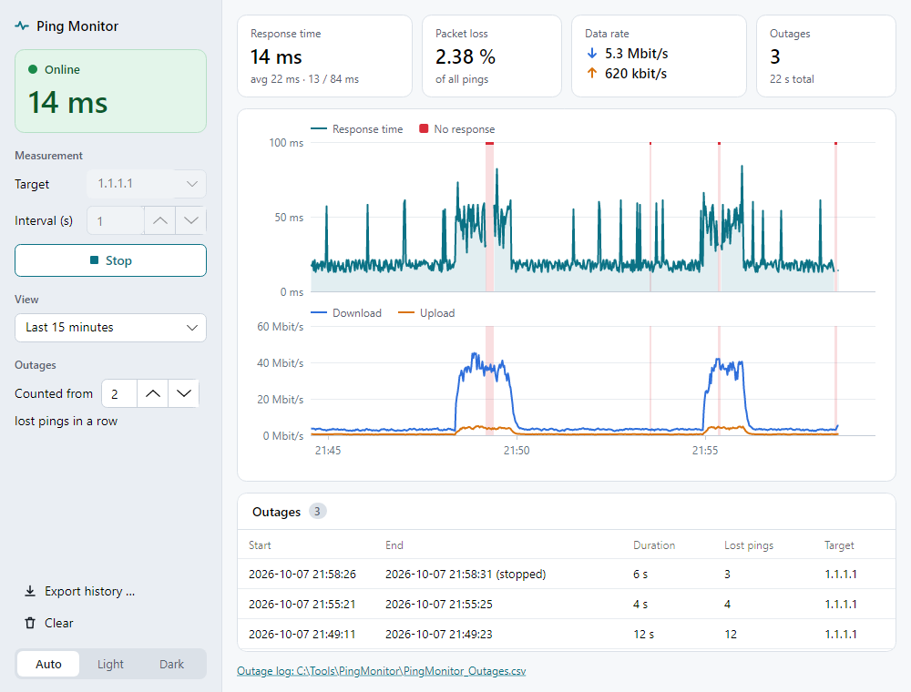

# Ping Monitor

Ping Monitor is a small desktop app that records when your internet connection goes down and when it comes back.
It pings a target at a fixed interval, logs every outage to a CSV file, and plots the response time next to
your computer's network throughput, so you can see whether disruptions coincide with heavy load.



## Contents

- [Features](#features)
- [Download](#download)
- [Requirements](#requirements)
- [Getting started](#getting-started)
- [Usage](#usage)
- [Output files](#output-files)
- [Project structure](#project-structure)
- [Tests](#tests)
- [Releasing](#releasing)
- [Known limitations](#known-limitations)
- [Contributing](#contributing)
- [License](#license)

## Features

- **Continuous ping** of an IP address or host name, every 1 to 60 seconds.
- **Outage detection** with an adjustable threshold: a disruption counts as an outage after a number of
  consecutive lost pings that you choose (2 by default).
- **Live graph** of response time and download/upload rate on a shared time axis. Zoom with the mouse wheel,
  pan by dragging, and use the overview bar to move through the entire history.
- **Key figures** at a glance: current, average, minimum and maximum response time, packet loss, data rate,
  number of outages and total downtime.
- **Outage log**: every outage is appended to a CSV file as soon as it ends.
- **History export**: all samples of the session can be saved as a CSV file.
- **Light and dark appearance**, or follow the system setting.
- The window title carries the current status, so it stays visible in the taskbar.

## Download

Ready-to-run packages are on the [releases page](../../releases). They include the .NET runtime, so nothing
else has to be installed.

| System | File | To start |
| --- | --- | --- |
| Windows (x64) | `PingMonitor-<version>-win-x64.zip` | Extract, then run `PingMonitor.exe` |
| Linux (x64) | `PingMonitor-<version>-linux-x64.tar.gz` | Extract, then run `./PingMonitor` |
| macOS (Apple silicon) | `PingMonitor-<version>-osx-arm64.zip` | Extract, then open `Ping Monitor.app` |

The packages are not code-signed, so Windows and macOS ask for confirmation before the first start:

- **Windows** shows "Windows protected your PC". Choose **More info**, then **Run anyway**.
- **macOS** refuses to open the app and says that Apple could not verify it is free of malware. Close that
  message with **Done**, then open **System Settings › Privacy & Security**, scroll down to **Security** and
  choose **Open Anyway**. The button only appears after a refused start and stays for about an hour.
  Alternatively, remove the download mark in Terminal, in the folder that holds the app, and start it again:

  ```shell
  xattr -dr com.apple.quarantine "Ping Monitor.app"
  ```

Every package comes with a build attestation: a signed record that it was built from this repository by the
[release workflow](.github/workflows/release.yml) and has not been changed since. The
[GitHub CLI](https://cli.github.com/manual/gh_attestation_verify) checks it:

```shell
gh attestation verify PingMonitor-1.0.0-win-x64.zip --repo arhofmann/ping-monitor
```

## Requirements

| To | You need |
| --- | --- |
| run a downloaded package | nothing else |
| build or run from source | [.NET 10 SDK](https://dotnet.microsoft.com/download) |
| run a build you published yourself, as described below | .NET 10 runtime |

Ping Monitor is developed and tested on Windows 10 and later. The user interface is built with
[Avalonia](https://avaloniaui.net/), which also runs on Linux and macOS, and the code avoids anything
Windows-specific — but those platforms have not been tested yet. Depending on the system configuration,
sending pings may require additional privileges there.

## Getting started

Run the app straight from the repository root:

```shell
dotnet run --project src/PingMonitor.Avalonia
```

### Building a single-file executable

On Windows, `build.cmd` publishes `PingMonitor.exe` into the repository root. It is a single file that only
needs the .NET runtime to start:

```bat
build.cmd
```

For another platform, publish with the matching
[runtime identifier](https://learn.microsoft.com/dotnet/core/rid-catalog), for example:

```shell
dotnet publish src/PingMonitor.Avalonia --configuration Release --runtime linux-x64 --output publish -p:SelfContained=false -p:PublishSingleFile=true -p:IncludeNativeLibrariesForSelfExtract=true -p:DebugType=embedded
```

## Usage

1. Enter a **Target**: an IP address or a host name. `1.1.1.1` (Cloudflare), `8.8.8.8` (Google) and
   `9.9.9.9` (Quad9) are offered as presets; they are public servers that cope well with continuous pings.
2. Choose the **Interval** between two pings and press **Start**.
3. Under **Outages**, set how many lost pings in a row make an outage.
4. Watch the graph. The box under **View** sets the time range it shows, from the last 5 minutes to the
   entire history.

**Export history …** saves all samples as a CSV file. **Clear** discards the history, the statistics and the
list of outages; what has already been written to the outage log stays there.

Working with the graph:

| Action | Effect |
| --- | --- |
| Mouse wheel | Zoom in and out around the pointer |
| Drag, or Shift + mouse wheel | Move the time window |
| Click or drag in the overview bar | Jump to another part of the history |
| Hover | Show the values of the sample under the pointer |

While the graph shows the past, **Back to live** in its upper right corner leads back to the present.

A few things worth knowing:

- Host names are resolved once, when the measurement starts. During an outage a DNS query could hang, and the
  monitor would then measure DNS instead of the connection.
- A ping counts as lost if no response arrives within the interval, or within 3 seconds if the interval is
  longer than that.
- The data rate is read from the network interface through which the target is reached. Only this computer's
  traffic is counted; what other devices on the network transfer is not visible.
- The history is kept in memory, up to 2,000,000 samples — a good three weeks at one ping per second. It is
  gone when the app closes, unless you export it. The outage log is written to disk right away.
- On screen, numbers, dates and times follow the regional settings of the system: decimal separator, order of
  day and month, 12- or 24-hour clock. The output files do not — they look the same on every machine.

## Output files

Both files use semicolons as separators and are UTF-8 encoded with a byte order mark. Timestamps are in local
time, formatted `yyyy-MM-dd HH:mm:ss` whatever the regional settings.

### Outage log: `PingMonitor_Outages.csv`

The log is created next to the executable. If that folder is not writable, it goes to
`PingMonitor/PingMonitor_Outages.csv` in your documents folder instead. The same happens when the program runs
from a macOS app bundle such as `Ping Monitor.app`: inside the bundle the log would be hidden in Finder and
lost as soon as the app is replaced by a newer version. The path is shown at the bottom of the window;
clicking it opens the folder.

```csv
Target;Start;End;Duration (seconds);Lost pings;Note
1.1.1.1;2026-10-07 14:24:47;2026-10-07 14:24:52;5;5;
1.1.1.1;2026-10-07 16:15:21;2026-10-07 16:15:27;6;3;Measurement stopped before the outage ended
```

| Column | Meaning |
| --- | --- |
| `Target` | The address or name that was pinged |
| `Start` | Time of the first lost ping |
| `End` | Time of the first ping that got through again |
| `Duration (seconds)` | Length of the outage, rounded to whole seconds |
| `Lost pings` | Number of consecutive pings without a response |
| `Note` | `Measurement stopped before the outage ended` if the measurement was stopped or cleared, or the app was closed, during the outage; otherwise empty |

### History export: `PingHistory_<date>_<time>.csv`

The export contains one row per ping. You choose where to save it.

```csv
Time;Result;Response time (ms);Download (kbit/s);Upload (kbit/s)
2026-10-07 14:24:46;OK;23;12346;512
2026-10-07 14:24:47;No response;;12101;498
```

| Column | Meaning |
| --- | --- |
| `Time` | When the ping was sent |
| `Result` | `OK` or `No response` |
| `Response time (ms)` | Round-trip time; empty for a lost ping |
| `Download (kbit/s)`, `Upload (kbit/s)` | Average data rate since the previous ping; empty if it could not be measured |

## Project structure

```text
src/
  PingMonitor.Core/        Measuring, outage detection, statistics, graph model, CSV output
  PingMonitor.Avalonia/    The user interface - it only displays and passes input on
tests/
  PingMonitor.Core.Tests/  Tests of the core
```

The core deliberately has no package or project references. That keeps every UI toolkit out of it, so the
user interface can be replaced without touching the logic.

How the ping is sent and how the traffic is counted is replaceable as well: both sit behind the interfaces
`IPinger` and `ITrafficCounter`, and the program is wired together in one place,
[App.axaml.cs](src/PingMonitor.Avalonia/App.axaml.cs).

## Tests

```shell
dotnet run --project tests/PingMonitor.Core.Tests
```

On Windows, `test.cmd` does the same. The tests need no test framework: every public static method without
parameters in a class whose name ends with `Tests` is a test, and it fails by throwing an exception. The exit
code is non-zero if a test fails.

## Releasing

1. Raise `Version` in [Directory.Build.props](Directory.Build.props) and commit.
2. Tag that commit `v<version>`, for example `v1.2.0`, and push the tag.
3. The [release workflow](.github/workflows/release.yml) tests and builds the packages for all three systems
   and attaches them to a draft release. Try them out, then publish the draft.

Started by hand from the Actions tab, the workflow only builds the packages and attaches them to the run.

## Known limitations

- Linux and macOS are untested.
- The downloads are not code-signed, so Windows and macOS warn before the first start.
- The user interface is available in English only.
- Only one target can be monitored at a time.
- The history does not survive a restart; only the outage log does.

## Contributing

Bug reports, ideas and pull requests are welcome. Before you open a pull request:

- Keep the core free of dependencies. Anything that needs a UI toolkit belongs in the user interface project.
- Write code, comments and identifiers in English, and match the style of the surrounding code.
- Add tests for changes to the core, and make sure all tests pass.
- For larger changes, open an issue first so the approach can be discussed.

## License

Ping Monitor is released under the [MIT License](LICENSE).
